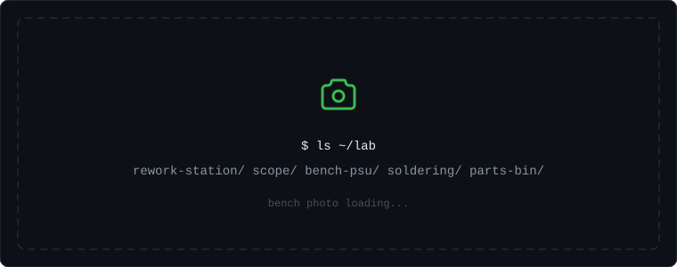

  

### 

| Project | What it does |
|---|---|
|  **[ade9000‑stm32h755](https://github.com/js0nnn/ade9000-stm32h755)** | Dual-core power-quality monitor with a hand-assembled SMD front end. **~1% V / 5% I error** STM32H755, SPI DMA, MQTT, Qt |
|  **[led‑matrix‑32x128](https://github.com/js0nnn/32x128-Large-LED-Matrix-Display)** | Wall clock built from four 32×32 panels (days, hours, minutes, seconds), **4,096 LEDs** synced to NTP over Wi-Fi ESP32, MAX72xx, NTP, Arduino |
|  **[tm‑seat‑v1](https://github.com/js0nnn/TM-SEAT-V1)** | Drowsiness-detection seat built with Tata Motors × VIT. **Alerts in 1.5–2 s**, SOS SMS with GPS STM32F407, TI AWR1642, VL53L0X, RPi 5 |
|  **[bench‑psu](https://github.com/js0nnn/DIY-Bench-Power-Supply)** | Arduino-controlled bench supply: LCD menu, live V / I / P readout, **constant-current mode**, switchable load and fan Arduino, ACS712, character LCD |

### 

  

### 

| Where | What |
|---|---|
| **SGF&nbsp;Labs** Sep 2026 – now | Firmware for STM32, ESP32 and nRF52, low-power integration and CI build/test pipelines |
| **Kivenetics** Nov 2025 – Apr 2026 | PySide/Qt apps for wheelchair control and vitals; Jetson Orin Nano + AWR6843 architecture |
| **Edsols&nbsp;Innovations** Jun – Jul 2025 | Edge-AI robotics on RPi 4B / Jetson Nano: motor control, obstacle avoidance |

<b>other work</b>: centrifuge retrofit, AI surveillance

 

- **AI-enhanced blood sample analysis**: retrofitted a lab centrifuge with RPi 5 + ESP32 control. FreeRTOS PID speed loop, encoder positioning and soft start; <1° rotor precision and 20% better speed regulation.
- **Context-configurable AI surveillance**: activity-aware rule engine on YOLO + ByteTrack. 25–28 FPS with one camera, 15–20 FPS with two.

### 

<!-- To add your bench photo: save it as assets/lab/bench.jpg (about 1600px wide),
     strip its metadata first (exiftool -all= assets/lab/bench.jpg) so no GPS location
     is published, then change the src below to assets/lab/bench.jpg. -->

  

### 

<b>hardware/</b>

 

- [Smart Seat V2](https://github.com/js0nnn/TM-SEAT-V2): multi-controller driver safety with heart-rate sensing and LTE + GPS alerts
- [Smart 3-Phase Energy Meter](https://github.com/js0nnn/Smart-3-Phase-Energy-Meter): per-phase power, PF and kWh streamed to Blynk
- [Wi-Fi Water Level Monitor](https://github.com/js0nnn/Wifi_Enabled_Water_Level_Monitor): ultrasonic tank level with OLED, buzzer and Blynk
- [PC-Based Oscilloscope](https://github.com/js0nnn/PC-Based-Oscilloscope): Arduino front end with a Python UI
- [Ultrasonic Radar](https://github.com/js0nnn/Ultrasonic-Radar): sonar-style obstacle mapping
- [Bluetooth Car](https://github.com/js0nnn/Bluetooth-Controlled-Car): phone-controlled RC car
- [Blynk Home Automation](https://github.com/js0nnn/Blynk-Home-Automation): appliance control over Wi-Fi
- [Timer Switch](https://github.com/js0nnn/Timer-Switch): LCD-set timer that cuts power via a relay
- [Household Projects](https://github.com/js0nnn/Household-Projects): smart door lock and smart trash bin

<b>software/</b>

 

- [E-Sentinel](https://github.com/E-Sentinel-Project/E-Sentinel): context-aware emergency response platform with offline SOS and neutrosophic fall detection, published in *Elsevier SoftwareX*
- [ChipDoc AI](https://github.com/js0nnn/chip-doc): offline datasheet Q&A with page citations; hybrid FAISS + BM25 RAG and a LoRA-tuned Qwen3-0.6B (right page cited 91% of the time vs 22% for the base model)
- [VITmate](https://github.com/js0nnn/VITmate): voice-first campus assistant using speech recognition and a transformer model over a curated VIT knowledge base
- [i-PACT Android App](https://github.com/js0nnn/i-PACT-Android-App): conference app for i-PACT, VIT

### 

- **[E-Sentinel: A context-aware emergency response platform with offline SOS support and neutrosophic fall detection](https://doi.org/10.1016/j.softx.2026.102632)** *Elsevier SoftwareX, 2026* | [code](https://github.com/E-Sentinel-Project/E-Sentinel)
- **[Grid Power 2.0: AI and IoT Optimizations in Smart Power Grids](https://doi.org/10.1109/aiiot58432.2024.10574687)** *IEEE AIIoT, 2024*

Full list on [ORCID 0009-0009-6416-4913](https://orcid.org/0009-0009-6416-4913)

### 

Chasing a weird SPI bug, bringing up a new board, or just want to nerd out about mmWave radar? Come say hi. I'm always up for talking firmware, internships, research collabs and side projects.

  &nbsp;
  &nbsp;
  &nbsp;
  &nbsp;
  

LinkedIn is the quickest way to reach me. "Say hi" opens an issue right here.

 

  

